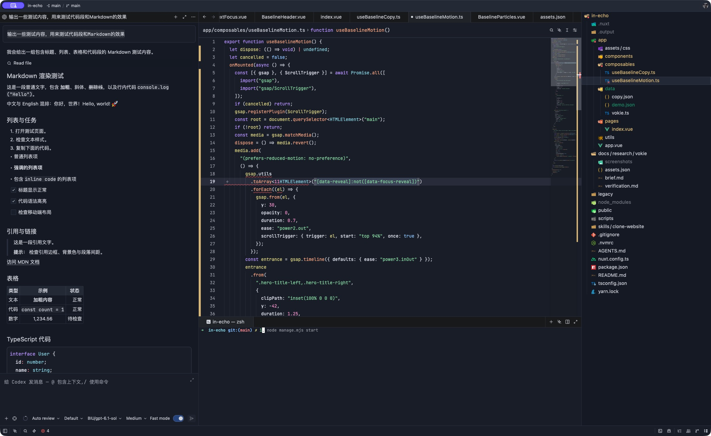

# Trae Deep Blue

[简体中文](README.md) | **English**

A dark theme for Zed adapted from Trae Deep Blue, covering syntax highlighting, the editor, file tree, menus, terminal, and Git status colors. Current version: **0.1.0**. Extension ID: `zed-deep-blue`.



## Installation

1. Run **zed: install dev extension** from the Zed command palette and select this repository root.
2. Run **theme selector: toggle** and select **Trae Deep Blue**.

Alternatively, install the theme file directly on macOS/Linux:

```sh
mkdir -p ~/.config/zed/themes
cp themes/trae-deep-blue.json ~/.config/zed/themes/
```

Reload Zed and select the theme. To uninstall, switch to another theme, then remove the development extension or the copied theme file.

## Recommended Settings

The theme controls colors; fonts, font sizes, and spacing require separate settings. The example below contains the current appearance settings and is also available in [settings/settings.example.json](settings/settings.example.json).

Merge these fields into the top level of your Zed user settings. **Do not replace your entire settings.json.** Merge existing terminal and project_panel objects by field, preserving their other settings.

```json
{
  "theme": "Trae Deep Blue",
  "ui_font_family": "SF Pro Text",
  "ui_font_size": 16,
  "buffer_font_family": "JetBrains Mono",
  "buffer_font_size": 13,
  "buffer_line_height": { "custom": 1.75 },
  "agent_ui_font_size": 16,
  "agent_buffer_font_size": 14,
  "markdown_preview": {
    "font_size": 14
  },
  "terminal": {
    "font_family": "JetBrains Mono",
    "font_size": 12,
    "line_height": "standard"
  },
  "project_panel": {
    "entry_spacing": "standard",
    "indent_size": 20,
    "sticky_scroll": false
  }
}
```

The font choices target macOS and require **SF Pro Text** and **JetBrains Mono** to be installed. Choose available fonts on other systems. Markdown preview prose and code blocks use different line-height rules: a code line height of 1.75 does not set the prose line height to 1.75.

You can also run this once from the repository root with Python 3.11+ and no additional dependencies:

```sh
python3 scripts/apply-appearance.py
```

The script merges settings from the same example file, preserves comments and non-appearance settings, and creates a private backup before updating. Use `--check` to check for differences without writing, or `--settings PATH` to select a settings file.

To reset accidental zoom on macOS, click inside the code editor or Markdown preview and press **⌘0** to restore that area's configured font size.

## Highlight Preview

The JSON settings above demonstrate key names, strings, numbers, and booleans. This TypeScript example demonstrates additional syntax colors:

```typescript
interface PreviewOptions {
  name: string;
  enabled: boolean;
}

// Mixed Chinese and English: types, functions, keywords, and strings.
function describePreview(options: PreviewOptions): string {
  const count = 3;
  return options.enabled ? options.name + "：" + count + " 个样例" : "预览已关闭";
}
```

Compare plain text, **bold text**, and inline code such as `font_size: 14`. Inline code usually has a single color. Fenced code blocks need a language label and the corresponding language support installed. More examples are available in [preview/](preview/).

## Notes and License

The theme cannot change component layout, corner radii, icons, individual widget font sizes, or table cell padding. Zed and Trae use different syntax parsers and text rendering, so this is not a pixel-perfect reproduction.

- [Color sources and adaptations](docs/mapping.md) (Chinese)
- [Fonts and spacing](docs/appearance.md) (Chinese)
- [Validation notes](docs/validation.md) (Chinese)
- [Zed theme documentation](https://zed.dev/docs/themes)

Licensed under the [MIT License](LICENSE), with upstream notices preserved. This is an unofficial extension; see [third-party notices](THIRD_PARTY_NOTICES.md).
